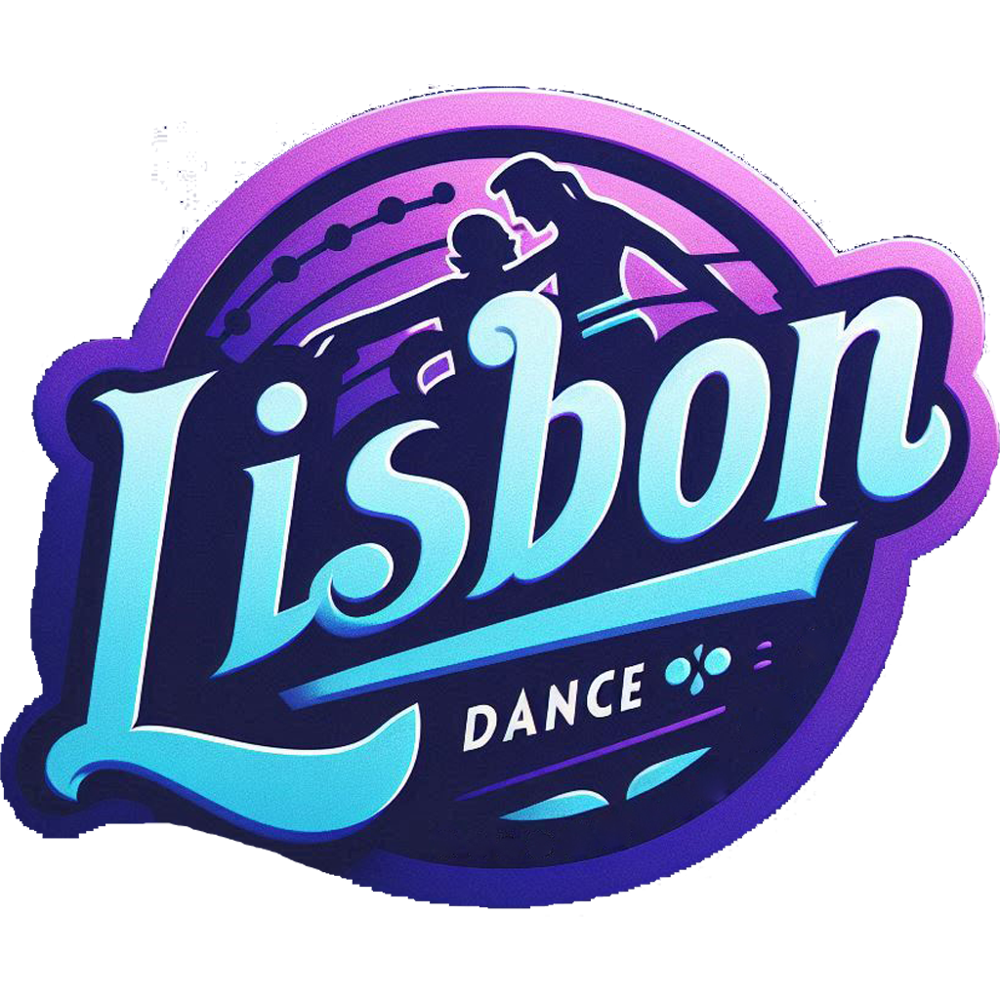
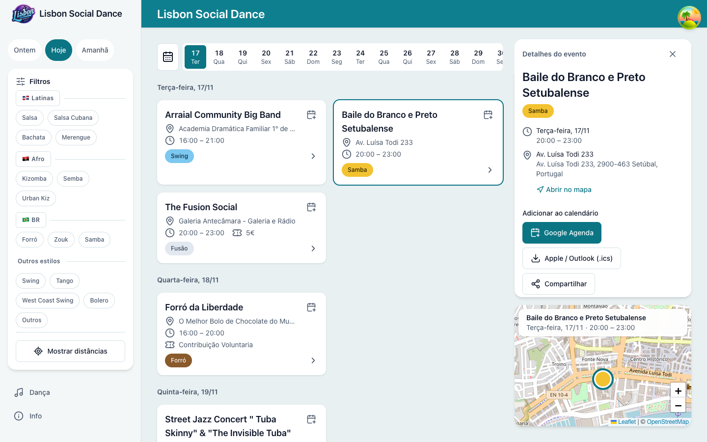
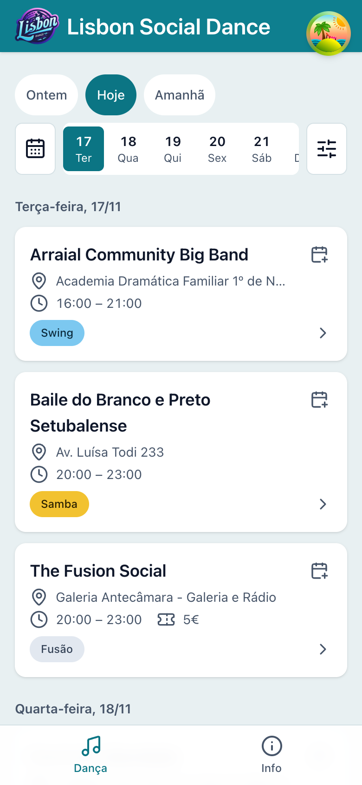
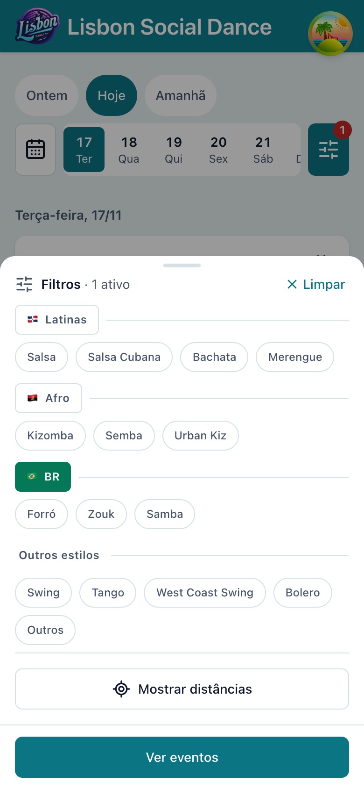
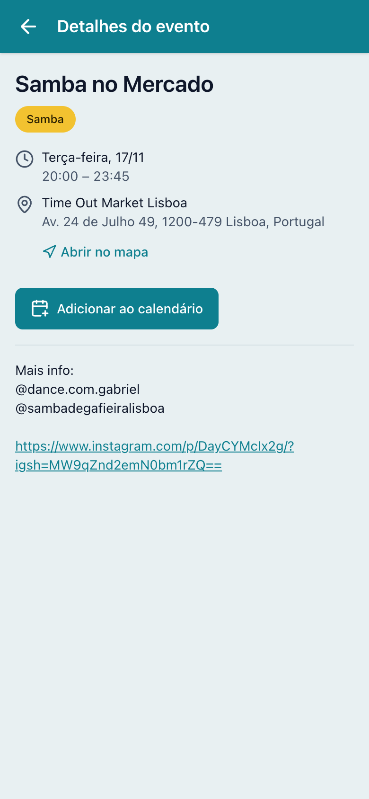

<p align="center">
  
</p>

<h1 align="center">Lisbon Social Dance</h1>

<p align="center">
  Agenda de práticas, festas e eventos de dança social em Lisboa — num PWA instalável, com filtros por estilo, mapa e funcionamento offline.
  <br />
  <a href="https://carloshrabelo.github.io/ai/"><strong>carloshrabelo.github.io/ai</strong></a>
</p>

---

## Prints

### Desktop

| Lista e mapa | Detalhes do evento | Tema escuro com filtro |
|---|---|---|
|  |  |  |

### Celular

| Lista | Filtros | Detalhes | Tema escuro |
|---|---|---|---|
|  |  |  |  |

## Funcionalidades

- **Feed por dia** a partir de hoje, carregado em janelas de 2 semanas com scroll infinito; atalhos Ontem / Hoje / Amanhã, faixa de dias e seletor de data. O dia ativo acompanha a rolagem.
- **Filtros por estilo**, acumulativos e guardados na URL (`?genres=salsa,forro`). Conjuntos 🇩🇴 **Latinas** (Salsa, Salsa Cubana, Bachata, Merengue), 🇦🇴 **Afro** (Kizomba, Semba, Urban Kiz) e 🇧🇷 **BR** (Forró, Zouk, Samba), mais Swing, West Coast Swing, Tango, Bolero e Outros.
- **Mapa** (a partir de 1280px) com os eventos do dia ativo; hover no card destaca o pino e vice-versa.
- **Detalhes do evento**: na coluna do mapa no desktop, numa página em drawer no celular. Link compartilhável (`?event=…`), rota no app de navegação do aparelho e "Adicionar ao calendário".
- **Distância** até cada evento, quando o usuário libera a localização.
- **Eventos cancelados e adiados** marcados a partir do título do calendário.
- **Tema claro e escuro** (segue o sistema ou escolha manual).
- **Português (pt-BR) e inglês (en-US)**: o idioma vem do navegador (qualquer `pt-*` → pt-BR; o resto → en-US) ou é escolhido em Info. Datas, horas, distâncias e listas são formatadas com `Intl`.
- **Adicionar ao calendário** sem login (Google Agenda preenchido ou `.ics` para Apple/Outlook) e **aviso de mudanças** nos eventos adicionados (horário, local, cancelamento), guardados no aparelho.
- **Compartilhar** pelo menu do sistema ou copiando o link.
- **Analytics** sem cookies (GoatCounter): páginas, filtros, datas, eventos abertos, calendário, compartilhamentos e rotas.
- **PWA**: instalável, abre offline com os últimos eventos carregados e se atualiza sozinho a cada deploy.

## Dados e créditos

- Eventos do calendário público do [pasdedeux.pt](https://pasdedeux.pt/), mantido por [@ateterca](https://www.instagram.com/ateterca/), lidos pela Google Calendar API.
- Mapa e coordenadas: © colaboradores do [OpenStreetMap](https://www.openstreetmap.org/copyright) (tiles do OSM, Nominatim e Photon).
- Desenvolvido por [carloshrabelo.dev](https://carloshrabelo.dev/).

## Stack

React 19 · TypeScript · Vite · React Router (data router) · TanStack Query (com persistência offline) · Tailwind CSS v4 · Leaflet / react-leaflet · vite-plugin-pwa (Workbox) · DOMPurify · Vitest · oxlint · pnpm.

## Como rodar

Requisitos: Node 22 e pnpm.

```bash
pnpm install
cp .env.example .env.local   # ajuste as variáveis abaixo
pnpm dev
```

### Variáveis de ambiente (`.env.local`)

| Variável | Para quê |
|---|---|
| `VITE_USE_MOCK` | `true` (padrão) usa `src/mocks/events.json`, com as datas deslocadas para perto de hoje; `false` usa a Google Calendar API. |
| `VITE_GOOGLE_API_KEY` | Chave da Google Calendar API (obrigatória com `VITE_USE_MOCK=false`). Restrinja por *HTTP referrer* no Google Cloud: ela fica visível no JavaScript publicado. |
| `VITE_MOCK_DELAY_MS` | Atraso artificial do mock, para ver os skeletons. |
| `VITE_GOATCOUNTER_CODE` | Código do site no [GoatCounter](https://www.goatcounter.com) (analytics sem cookies). Vazio = desligado; em `pnpm dev` fica sempre desligado. |

### Scripts

| Comando | O que faz |
|---|---|
| `pnpm dev` | Servidor de desenvolvimento (sem service worker; use `PWA_DEV=true pnpm dev` para testar o PWA). |
| `pnpm build` | Checagem de tipos + build de produção. |
| `pnpm preview` | Serve o build localmente. |
| `pnpm test` / `pnpm test:watch` | Testes (Vitest). |
| `pnpm lint` | Lint (oxlint). |
| `pnpm venues:check [dias] [--fix]` | Lista os locais dos próximos eventos sem coordenadas; com `--fix`, busca e grava em `src/data/venues.json`. |
| `pnpm a11y [url]` | Auditoria de acessibilidade (axe-core, WCAG 2.1 AA) nas telas principais; precisa do `pnpm preview` rodando. |
| `pnpm generate-pwa-assets` | Gera os ícones do PWA a partir de `docs/assets/logo_square.png`. |

## Estrutura

```
src/
  data/        fonte dos eventos (API/mock), datas, TanStack Query, venues.json
  domain/      modelo DanceEvent, parser de gêneros e do título, regras do filtro
  i18n/        idioma (detecção, escolha salva) e textos pt-BR / en-US
  features/
    events/    feed, card, detalhes, seleção (eventFocusStore)
    dates/     atalhos de dia, faixa de dias, navegação por dia
    genres/    painel e estado dos filtros
    map/       mapa (Leaflet)
    location/  localização do usuário, distância, geocodificação, rotas
  components/  layout (header, sidebar, bottom nav) e componentes base (Chip, Card, Button…)
  pages/       Dança (/), Info (/info), Escolas (/escolas, oculta)
scripts/       venues-check.mjs
docs/          prints, logo e protótipos de referência
```

## Como os estilos são reconhecidos

O título dos eventos segue o padrão `Tag • Nome • Preço` (ex.: `SBK • Festa na Aerlis • 7€`).

- A **tag** passa por aliases (`SBK` → Salsa + Bachata + Kizomba, `WCS` → West Coast Swing, `Afro-Latinas` → Latinas + Afro…) e é comparada com a lista de gêneros (`src/domain/genres.ts`).
- Gêneros citados no **título ou na descrição** também entram (ex.: "70% Bachata / 30% Salsa").
- **Conjuntos** (Latinas, Afro, BR) são tags de reserva: só aparecem quando nenhum gênero deles foi citado, mas o evento conta nos filtros de todos os gêneros do conjunto. Numa tag composta como "Afro-Latinas", cada parte só fica se o conteúdo a confirmar.
- Prefixos como `(Cancelado)` ou `[Postponed]` viram aviso no card e tiram o evento do mapa.

## Locais e coordenadas

O texto de `location` de cada evento é a chave em `src/data/venues.json`. Locais que ainda não estão no arquivo:

1. são buscados **no navegador** (Photon) na primeira vez que o mapa, a distância ou a rota precisam deles, e ficam salvos no aparelho;
2. são gravados no arquivo pela Action diária **Update venues**, que roda `venues:check --fix` (Nominatim + Photon, só aceitando resultados da mesma região postal) e publica o site.

Para corrigir um ponto, edite as coordenadas no `venues.json`: a busca automática só adiciona locais novos.

## SEO

- Tags fixas no `index.html` (lidas por buscadores e redes sociais sem JavaScript): título, descrição, canonical, `hreflang`, Open Graph e Twitter Card com `public/og-image.jpg`.
- `<head>` dinâmico por página (`src/seo/`): título e descrição próprios, canonical, `noindex` para 404 e eventos inexistentes, e Schema.org em JSON-LD (`ItemList` na agenda, `DanceEvent` no evento aberto).
- No build: `sitemap.xml`, `robots.txt` e `info/index.html` (para `/ai/info` responder 200 no GitHub Pages em vez de cair no 404).
- Limitações de ser SPA no GitHub Pages: o conteúdo dos eventos não está no HTML inicial; o `robots.txt` que vale é o da raiz do domínio; não há redirecionamento 301 (evento removido recebe `noindex` e aponta para a agenda).

## Deploy

GitHub Pages, pelo workflow `.github/workflows/deploy.yml` a cada push no `main` (lint e testes antes do build).

Em **Settings → Secrets and variables → Actions**:

| Nome | Tipo | Valor |
|---|---|---|
| `VITE_GOOGLE_API_KEY` | Secret | Chave da Google Calendar API |
| `VITE_USE_MOCK` | Variable | `false` para usar a API (sem ela, o site publica com o mock) |
| `VITE_GOATCOUNTER_CODE` | Variable | Código do site no GoatCounter (opcional) |

O workflow `.github/workflows/venues.yml` (**Update venues**) roda todo dia às 05:00 UTC e também pode ser disparado manualmente.

## Planejamento

O plano de implementação, as decisões e o histórico de cada etapa estão em [`PLANO.md`](PLANO.md).
