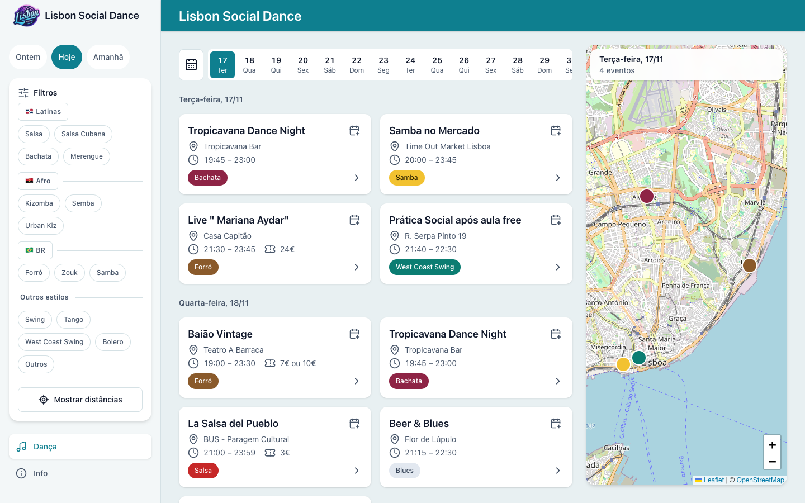
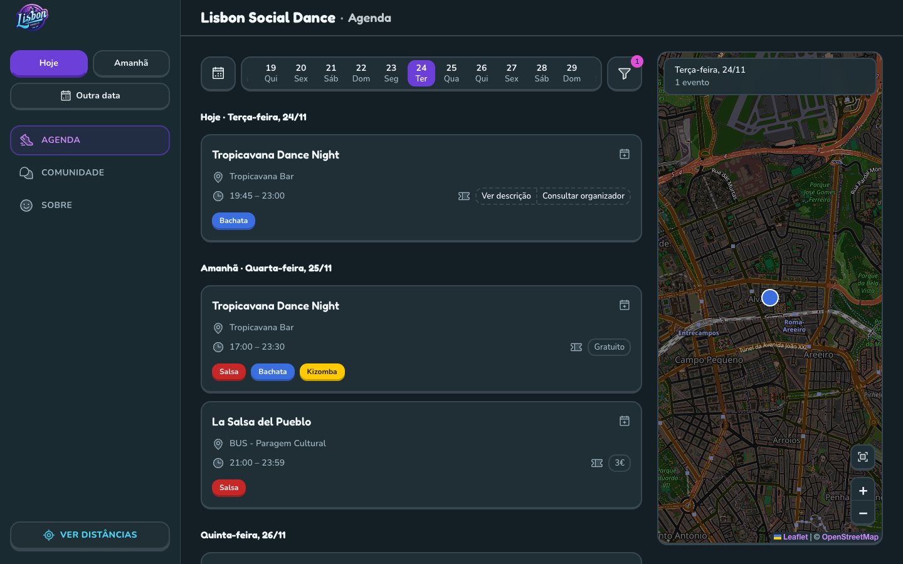
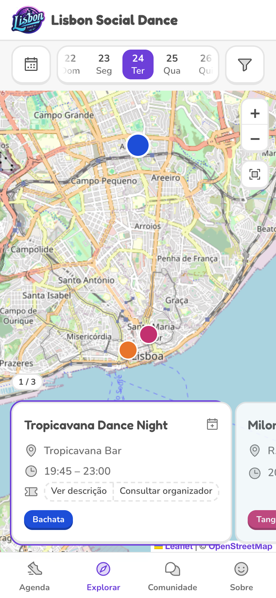
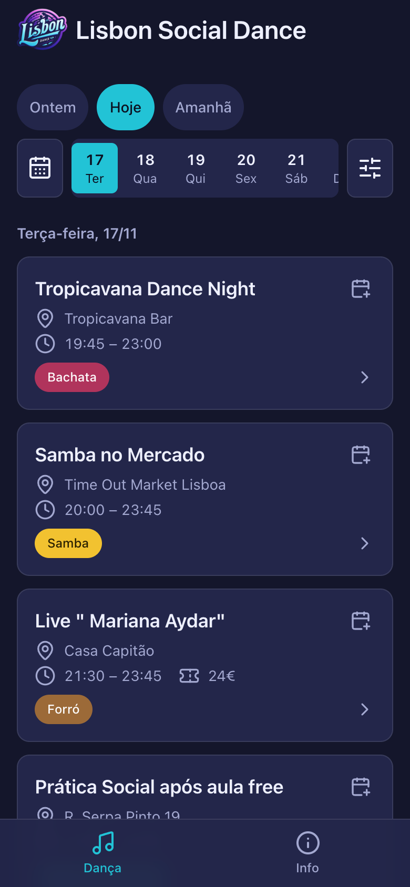

<p align="center">
  
</p>

<h1 align="center">Lisbon Social Dance</h1>

<p align="center">
  Agenda de práticas, festas e eventos de dança social em Lisboa — num PWA instalável, com filtros por estilo, mapa e funcionamento offline.
  <br />
  <a href="https://carloshrabelo.github.io/ai/"><strong>carloshrabelo.github.io/ai</strong></a>
</p>

<p align="center">
  <a href="https://github.com/carloshrabelo/ai/actions/workflows/deploy.yml"></a>
  
  
  
  
  
  
  
  
  
  
</p>

---

## Prints

### Desktop

| Lista e mapa | Detalhes do evento | Tema escuro com filtro |
|---|---|---|
|  |  |  |

### Celular

| Lista | Filtros | Detalhes | Mapa | Tema escuro |
|---|---|---|---|---|
|  |  |  |  |  |

## Funcionalidades

- **Feed por dia** a partir de hoje, carregado em janelas de 2 semanas com scroll infinito; atalhos Hoje / Amanhã / Outra data (abre o calendário), e Ontem de madrugada ou quando o dia em foco é ontem; até as 05:00 o "hoje" da agenda ainda é a noite anterior, faixa de dias (com a semana anterior; o dia ativo fica sempre no centro) e calendário do mês, que troca de mês deslizando para os lados no celular e no tablet. O dia ativo acompanha a rolagem e é mantido ao trocar entre a agenda e o mapa.
- **Filtros por estilo** (na barra lateral no desktop; numa folha que sobe de baixo no celular e tablet), acumulativos e guardados na URL (`?genres=salsa,forro`). Conjuntos 🇩🇴 **Latinas** (Salsa, Salsa Cubana, Bachata, Merengue), 🇦🇴 **Afro** (Kizomba, Semba, Urban Kiz) e 🇧🇷 **BR** (Forró, Zouk, Samba), mais Swing, West Coast Swing, Tango, Bolero e Outros.
- **Mapa** com os eventos do dia: a partir de 1280px, numa coluna ao lado da lista (hover no card destaca o pino e vice-versa); no celular e tablet, na página **Mapa** (`/map`), com a faixa de dias em cima e os eventos num carrossel embaixo (títulos em até 2 linhas). O mapa busca as próprias datas: a faixa carrega mais dias ao chegar no fim e o calendário vai para qualquer data, sem depender do que a agenda já carregou. O card visível fica em foco no mapa, tocar num pino traz o card dele e tocar no card abre os detalhes.
- **Detalhes do evento**: na coluna do mapa no desktop, numa página em drawer no celular, com a descrição completa. Link compartilhável (`/event/<data>-<nome>-<hash>/`, com página estática), rota no app de navegação do aparelho e "Adicionar ao calendário".
- **Distância** até cada evento, quando o usuário libera a localização.
- **Eventos cancelados e adiados** marcados a partir do título do calendário.
- **Tema claro e escuro** (segue o sistema ou escolha manual).
- **Português (pt-BR) e inglês (en-US)**: o idioma vem do navegador (qualquer `pt-*` → pt-BR; o resto → en-US) ou é escolhido em Info. Datas, horas, distâncias e listas são formatadas com `Intl`.
- **Adicionar ao calendário** sem login (Google Agenda preenchido ou `.ics` para Apple/Outlook) e **aviso de mudanças** nos eventos adicionados (horário, local, cancelamento), guardados no aparelho.
- **Compartilhar** pelo menu do sistema ou copiando o link.
- **Comunidade**: outros calendários, grupos e perfis; os calendários do Pas de Deux podem ser assinados no Google Agenda (Android), no Calendário da Apple (iPhone/Mac, `webcal://`) ou por link `.ics`.
- **PWA**: instalável (aviso de instalação com o convite do navegador, ou instruções no iPhone/iPad; dispensado, só volta depois de 30 dias), abre offline com os últimos eventos carregados e se atualiza sozinho a cada deploy.

## Dados e créditos

- Eventos do calendário público do [pasdedeux.pt](https://pasdedeux.pt/), mantido por [@ateterca](https://www.instagram.com/ateterca/), lidos pela Google Calendar API.
- Também os calendários públicos de tango (`agendatangolx@gmail.com`, da agenda do [tangolx.com](https://www.tangolx.com/)) e de danças tradicionais europeias (`europeias.agenda@gmail.com`, mantido por Luís Manuel Guerra), na mesma lista. Cada um tem um adaptador (`src/domain/calendarSources.ts`) que converte o evento para o formato do principal (tag, nome e preço no título; local; hora). As danças tradicionais incluem eventos fora de Lisboa.
- Mapa e coordenadas: © colaboradores do [OpenStreetMap](https://www.openstreetmap.org/copyright) (tiles do OSM, Nominatim e Photon).
- Desenvolvido por [carloshrabelo.dev](https://carloshrabelo.dev/).

## Stack

React 19 · TypeScript 7 · Vite 8 (Rolldown) · React Router 8 (data router) · TanStack Query 5 (dados do servidor, com persistência offline) · Zustand 5 (estado do app) · Tailwind CSS v4 · Leaflet / react-leaflet · vite-plugin-pwa (Workbox) · DOMPurify · Phosphor Icons · Vitest + Testing Library · Playwright + axe · oxlint / oxfmt · Knip · pnpm.

Análise de cada escolha, limitações e recomendações: [`Stack.MD`](Stack.MD).

### Estado

- **Dados do servidor** (eventos, geocodificação): TanStack Query, salvos no aparelho por 24 h para abrir offline.
- **Estado do app**: stores Zustand. Os salvos no aparelho usam `persist` com um adaptador (`src/lib/persistStorage.ts`) que grava **no mesmo formato de antes** de cada chave do `localStorage`, para não perder o que já estava salvo:

  | Store | Arquivo | Chave | Formato |
  |---|---|---|---|
  | Tema | `src/theme/useTheme.ts` | `theme` | `light` / `dark` em texto (Sistema = sem chave); lido também pelo script inline do `index.html` |
  | Idioma | `src/i18n/locale.ts` | `locale` | `pt-BR` / `en-US` em texto (Automático = sem chave) |
  | Eventos acompanhados | `src/features/tracking/trackedEvents.ts` | `tracked-events` | JSON `{ [id]: snapshot }` |
  | Palavras ignoradas (/review) | `src/features/review/ignoredWords.ts` | `lisbon-social-dance:review-ignored` | JSON `string[]` |
  | Aviso de instalação dispensado | `src/pwa/installPrompt.ts` | `install-prompt-dismissed` | timestamp em texto |

  Só em memória: seleção e hover de eventos (`eventFocusStore`), localização do usuário e dia em foco compartilhado entre agenda e mapa (`focusedDayStore`).
- **Na URL**: filtro de gêneros (`?genres=`), início do feed (`?date=`), dia do mapa (`?day=`) e evento aberto (`/event/<slug>/`).

## Como rodar

Requisitos: Node 22 e pnpm.

```bash
pnpm install
cp .env.example .env.local   # ajuste as variáveis abaixo
pnpm dev
```

### Variáveis de ambiente (`.env.local`)

| Variável | Para quê |
|---|---|
| `VITE_USE_MOCK` | `true` (padrão) usa `src/mocks/events.json`, com as datas deslocadas para perto de hoje; `false` usa a Google Calendar API. |
| `VITE_GOOGLE_API_KEY` | Chave da Google Calendar API (obrigatória com `VITE_USE_MOCK=false`). Restrinja por *HTTP referrer* no Google Cloud: ela fica visível no JavaScript publicado. |
| `VITE_MOCK_DELAY_MS` | Atraso artificial do mock, para ver os skeletons. |
| `VITE_TEST_PAGES` | `true` mostra o link "Teste" no menu (só local, não configure no deploy). A área `/test`, com as ferramentas internas (como `/test/prices`, que lista os preços distintos dos eventos e a tradução de cada um), existe também no site publicado para quem tem o link, sem link no app e com noindex. |

### Scripts

| Comando | O que faz |
|---|---|
| `pnpm dev` | Servidor de desenvolvimento (sem service worker; use `PWA_DEV=true pnpm dev` para testar o PWA). |
| `pnpm build` | Checagem de tipos + build de produção + páginas estáticas dos eventos (`scripts/prerender.ts`). |
| `pnpm preview` | Serve o build localmente. |
| `pnpm analyze` | Build com a análise do bundle: gera e abre `bundle-stats.html` (ver abaixo). |
| `pnpm test` / `pnpm test:watch` | Testes (Vitest): domínio e componentes (React Testing Library, em jsdom; apoio em `src/test/`). |
| `pnpm lint` | Lint (oxlint). |
| `pnpm format` / `pnpm format:check` | Formata o código (oxfmt: aspas simples, sem ponto e vírgula, 140 colunas; Markdown fica de fora) / só confere, como no CI. |
| `pnpm knip` | Arquivos, exportações e dependências sem uso (Knip). Roda no CI. |
| `pnpm venues:check [dias] [--fix]` | Lista os locais dos próximos eventos sem coordenadas; com `--fix`, busca e grava em `src/content/venues.json`. |
| `pnpm e2e` | Testes de ponta a ponta (Playwright, em `e2e/`): fluxos principais no celular e no desktop, com o mock. Sobe o `pnpm dev` sozinho; localmente usa o Chrome instalado. Roda no CI antes do build. |
| `pnpm a11y` | Só a parte de acessibilidade do `e2e` (axe-core, WCAG 2.1 AA + boas práticas) nas telas principais, nos dois temas. |
| `pnpm generate-pwa-assets` | Gera os ícones do PWA a partir de `docs/assets/logo_square.png`. |
| `pnpm promoters:update` | Atualiza `src/content/promoters.json` (roda também numa Action). |

### Analisar o bundle

`pnpm analyze` roda o `vite build` com o [`rollup-plugin-visualizer`](https://github.com/btd/rollup-plugin-visualizer) (configurado em `vite.config.ts`, ligado só com `ANALYZE=true`) e grava `bundle-stats.html` na raiz — fora do `dist/`, para não ir para o deploy nem para o cache do service worker; o arquivo está no `.gitignore`. Com `CI` definido, não abre o navegador.

- O padrão é o **treemap**: cada retângulo é um módulo, com o tamanho proporcional ao código no bundle; passe o mouse para ver os tamanhos renderizado, gzip e brotli. Os blocos de fora são os chunks (`index` é o que carrega na abertura; `EventsMap`, `EventDetails`, páginas etc. são carregados sob demanda).
- Outras visões: `ANALYZE_TEMPLATE=sunburst pnpm analyze` (hierarquia), `network` (quem importa quem — útil para descobrir por que uma dependência entrou num chunk) ou `flamegraph`.
- O que olhar: dependências grandes no chunk `index` (custam na primeira carga), a mesma dependência em vários chunks e páginas de teste (`/test`) puxando bibliotecas para o bundle principal.

> Por que não o CLI `vite-bundle-visualizer`: ele traz o `rollup-plugin-visualizer` 5, que não suporta o Rolldown do Vite 8. O plugin na versão 7 suporta.

## Estrutura

```
src/
  api/         fonte dos eventos (Google Calendar API / mock), TanStack Query, loader das rotas
  content/     venues.json, promoters.json e links da Comunidade
  lib/         datas, localStorage seguro e adaptador de persistência do Zustand
  domain/      modelo DanceEvent, parser de gêneros e do título, regras do filtro
  i18n/        idioma (detecção, store da escolha salva) e textos pt-BR / en-US
  theme/       store do tema (claro / escuro / sistema)
  pwa/         convite de instalação e aviso dispensado
  features/
    events/    feed, card, detalhes, seleção (eventFocusStore), calendário (.ics / Google Agenda)
    dates/     atalhos de dia, faixa de dias, calendário, navegação por dia, dia em foco (focusedDayStore)
    genres/    painel e estado dos filtros
    map/       mapa (Leaflet)
    location/  localização do usuário, distância, geocodificação, rotas
    tracking/  eventos adicionados ao calendário e aviso de mudanças
    review/    revisão de texto dos eventos (/review)
  seo/         <head> por página, JSON-LD, páginas estáticas (prerender)
  components/  layout (header, sidebar, bottom nav) e componentes base (Chip, Card, Button…)
  pages/       Dança (/ e /event/<slug>/), Mapa (/map, celular), Comunidade (/community), Sobre (/about), Escolas (/schools, oculta)
scripts/       prerender.ts, venues-check.ts, promoters-update.ts
e2e/           testes de ponta a ponta e acessibilidade (Playwright)
docs/          prints, logo e protótipos de referência
```

## Analytics (rastreamento de cliques)

Os elementos clicáveis relevantes têm `data-track="<área>.<ação>"` e, quando há um valor, `data-track-value` (dia, slug do evento, gênero, rota, id do calendário…). Os nomes ficam num catálogo tipado em `src/analytics/track.ts` (`TrackId`) e são aplicados com `{...track('event.open', event.slug)}`. A página do clique vem de `location.pathname` (o mesmo `event.open` serve na lista, no mapa e no popup do pino).

- Para ligar uma ferramenta: `onTrackedClick(({ id, value, path }) => analytics.track(id, { value, path }))`, um listener só, delegado no `document` (fase de captura). Ferramentas que leem atributos (GTM com gatilho por atributo, PostHog autocapture, Plausible) podem usar `data-track` direto.
- Para conferir em dev: abra o app com `?track` na URL; cada clique rastreado aparece no console como `[track] { id, value, path }`.
- Áreas: `nav`, `dates`, `filters`, `event`, `map`, `location`, `community`, `settings`, `pwa`, `about`.

## Como os estilos são reconhecidos

O título dos eventos segue o padrão `Tag • Nome • Preço` (ex.: `SBK • Festa na Aerlis • 7€`).

- A **tag** passa por aliases (`SBK` → Salsa + Bachata + Kizomba, `WCS` → West Coast Swing, `Afro-Latinas` → Latinas + Afro…) e é comparada com a lista de gêneros (`src/domain/genres.ts`).
- Gêneros citados no **título ou na descrição** também entram (ex.: "70% Bachata / 30% Salsa").
- **Conjuntos** (Latinas, Afro, BR) são tags de reserva: só aparecem quando nenhum gênero deles foi citado, mas o evento conta nos filtros de todos os gêneros do conjunto. Numa tag composta como "Afro-Latinas", cada parte só fica se o conteúdo a confirmar.
- Prefixos como `(Cancelado)` ou `[Postponed]` viram aviso no card e tiram o evento do mapa.

## Locais e coordenadas

O texto de `location` de cada evento é a chave em `src/content/venues.json`. Locais que ainda não estão no arquivo:

1. são buscados **no navegador** (Photon) na primeira vez que o mapa, a distância ou a rota precisam deles, e ficam salvos no aparelho;
2. são gravados no arquivo pela Action diária **Update venues**, que roda `venues:check --fix` (Nominatim + Photon, só aceitando resultados da mesma região postal) e publica o site.

Para corrigir um ponto, edite as coordenadas no `venues.json`: a busca automática só adiciona locais novos.

## SEO

- Tags fixas no `index.html` (lidas por buscadores e redes sociais sem JavaScript): título, descrição, canonical, `hreflang`, Open Graph e Twitter Card com `public/og-image.jpg`.
- `<head>` dinâmico por página (`src/seo/`): título e descrição próprios, canonical, `noindex` para 404 e eventos inexistentes, e Schema.org em JSON-LD (`ItemList` na agenda, `DanceEvent` no evento aberto).
- No build: `sitemap.xml`, `robots.txt` e uma cópia do `index.html` por rota fixa (`map/`, `community/`, `about/`), para `/ai/about` responder 200 no GitHub Pages em vez de cair no 404.
- Páginas estáticas (SSG, `scripts/prerender.ts` depois do `vite build`): uma por evento em `event/<slug>/index.html` (de 1 semana atrás a 90 dias à frente), com título, descrição, canonical, Open Graph, JSON-LD e o conteúdo do evento no HTML; a agenda (`index.html`) traz a lista dos próximos eventos com links; o `sitemap.xml` inclui os eventos futuros. No navegador, o React substitui esse conteúdo pelo app. O deploy roda todo dia para as páginas acompanharem o calendário. Se a API falhar no build, saem só as páginas fixas.
- Slug do evento: dia de Lisboa + título + hash curto do id do Google (`src/domain/slug.ts`), sempre o mesmo para o mesmo evento. Links antigos (`?event=<id>`) são redirecionados para o novo endereço.
- Limitações do GitHub Pages: o `robots.txt` que vale é o da raiz do domínio; não há redirecionamento 301 (evento removido recebe `noindex` e aponta para a agenda).

## Deploy

GitHub Pages, pelo workflow `.github/workflows/deploy.yml` a cada push no `main` e todo dia às 05:30 UTC, para as páginas dos eventos acompanharem o calendário (lint e testes antes do build).

Em **Settings → Secrets and variables → Actions**:

| Nome | Tipo | Valor |
|---|---|---|
| `VITE_GOOGLE_API_KEY` | Secret | Chave da Google Calendar API |
| `VITE_USE_MOCK` | Variable | `false` para usar a API (sem ela, o site publica com o mock) |

O workflow `.github/workflows/venues.yml` (**Update venues**) roda todo dia às 05:00 UTC e também pode ser disparado manualmente.

O que ainda precisa ser feito ou conferido à mão (chaves, configurações, verificações) está em [`TODO.md`](TODO.md).

## Planejamento

O plano de implementação, as decisões e o histórico de cada etapa estão em [`PLANO.md`](PLANO.md).
