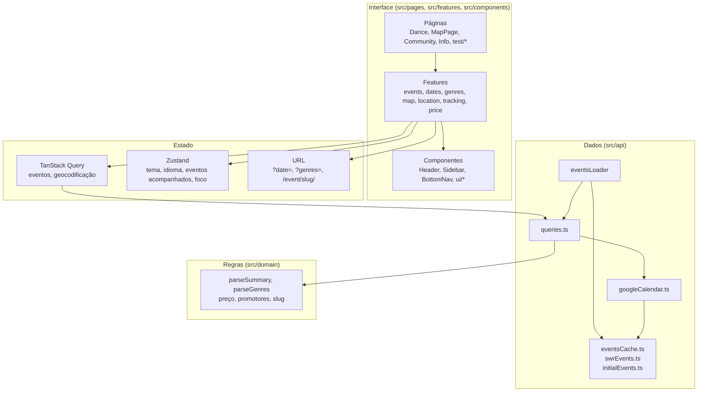
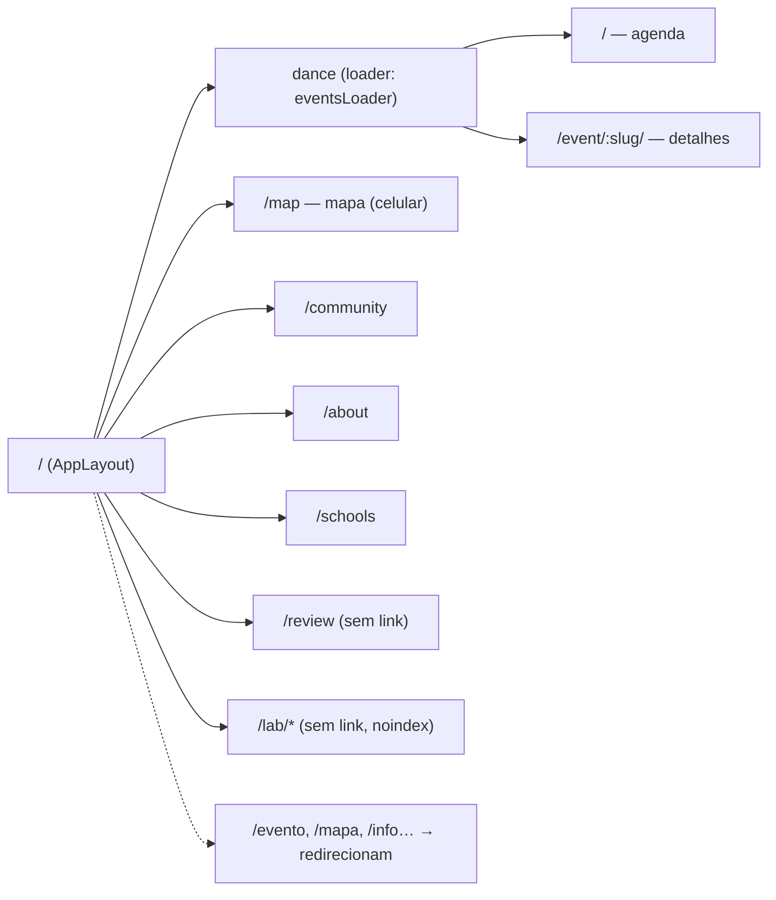
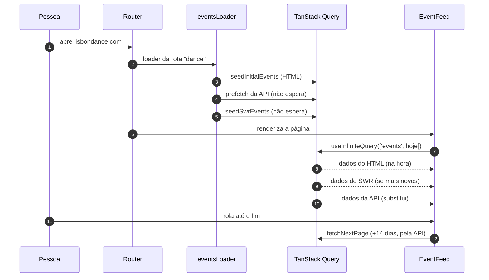
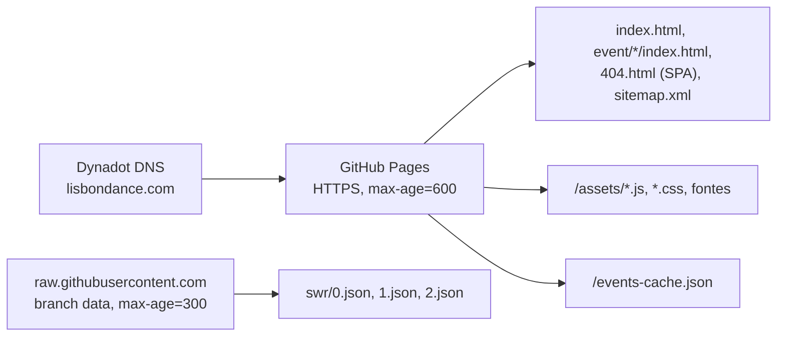

# 01. Arquitetura

Um **PWA estático**: React 19 + Vite, sem servidor próprio. Os eventos vêm da Google Calendar API (no navegador) e de
arquivos JSON gerados por GitHub Actions. O site é publicado no GitHub Pages.

## Camadas do código

| Pasta | O quê |
|---|---|
| `src/api` | Busca dos eventos (API, mock, caches), configuração e o `QueryClient` |
| `src/domain` | Regras puras: título → estilos, preço, local, promotores, slug, calendários |
| `src/features` | Cada funcionalidade com seus componentes e hooks (eventos, datas, estilos, mapa…) |
| `src/pages` | As rotas (carregadas sob demanda) |
| `src/seo` | `<head>` de cada página e a geração das páginas estáticas |
| `src/analytics` | GoatCounter, cliques marcados e recorrência de visitas |
| `src/i18n` | Português e inglês |
| `scripts/` | Scripts Node que usam o código do app (cache, SWR, prerender, venues, promoters) |

## Rotas

- A agenda e o detalhe do evento são **a mesma página** (rota pai `dance`): abrir e fechar um evento não remonta a
  lista.
- Todas as páginas são `lazy`: o JavaScript inicial tem só o framework, o layout e o roteador.
- O `eventsLoader` roda antes da página. Ele:
  - decide o dia inicial (`?date=` ou "hoje", que até as 05:00 ainda é ontem);
  - põe os eventos que já existem na query (HTML e SWR);
  - dispara a API.

## Do clique ao card

## Estado

| Onde | O quê | Persistido? |
|---|---|---|
| TanStack Query | Janelas de eventos (`['events', início]`), geocodificação | Sim, `localStorage`, 24 h (`queryClient.ts`) |
| Zustand | Tema, idioma, eventos acompanhados, aviso de instalação | Sim, `localStorage` (`persistStorage.ts`) |
| Zustand (`eventFocus`) | Card em foco / hover (lista ↔ mapa) | Não |
| URL | Dia (`?date=`), estilos (`?genres=`), evento aberto | Na própria URL (links compartilháveis) |

## Hospedagem

- **GitHub Pages:** não permite cabeçalhos próprios, então todo arquivo tem cache HTTP de 10 min. O service worker
  compensa a partir da segunda visita (ver [06](06-pwa-and-offline.md)).
- **Rotas sem página estática** (ex.: `/lab/...`): o GitHub Pages responde com o `404.html`, que é o próprio app, e o
  roteador assume.
