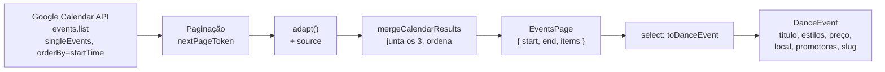
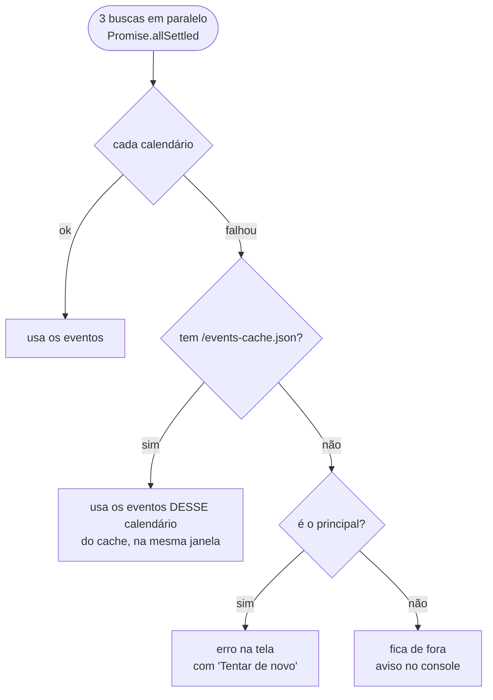

# 02. Dados dos eventos

## Fontes

Três calendários públicos do Google Agenda (`src/domain/calendarSources.ts`), buscados nessa ordem:

| `source` | Calendário | Quem mantém | Adaptação |
|---|---|---|---|
| `pasdedeux` | `pasdedeux.pt@gmail.com` | @ateterca | Nenhuma: é o formato de referência |
| `tangolx` | `agendatangolx@gmail.com` | tangolx.com | `fromTangoLx`: põe a tag "Tango" no título |
| `tradicionais` | `europeias.agenda@gmail.com` | Luís Manuel Guerra | `fromTradicionais`: tag "Tradicionais" |

O **primeiro é o principal**: se ele falhar sem cache, a busca falha. Os outros, se falharem, ficam de fora com um
aviso no console.

## Da API ao card

- **Janela:** 14 dias (`WINDOW_DAYS`). O feed pede uma janela por vez (`useInfiniteQuery`). Duas janelas vazias
  seguidas encerram o feed (`EMPTY_WINDOWS_TO_STOP`).
- **Normalização** (`toDanceEvent`, `src/domain/`):
  - **título:** "Kizomba • Festa Mirage • Pago" vira estilos, nome e preço (`parseSummary`, `parseGenres`, `ALIAS`
    para variações como `SBK`, `WCS`, `AFRO-LATINAS`);
  - **local** e **promotores**: a partir do `location` e da descrição;
  - **situação:** "(Cancelado)", "(Adiado)";
  - **slug:** `<data>-<nome>-<hash>`, para o link do evento.
- O `select` roda a normalização na leitura. O que vai para o cache e para o `localStorage` é o formato cru da API.

## Quando um calendário falha

- O `/events-cache.json` é buscado **só quando algo falha**, uma vez por sessão (`fetchPublishedCache`).
- Motivos comuns de falha: cota, chave recusada (ex.: domínio fora da restrição), rede ou bloqueador.

## Mock

Com `VITE_USE_MOCK` diferente de `false` (o padrão), os eventos vêm de `src/mocks/events.json`. As datas são deslocadas
para perto de hoje, para a agenda nunca ficar vazia. O mock é usado no `pnpm dev`, nos testes e no e2e. Nele, o SWR e
o cache publicado ficam desligados.
