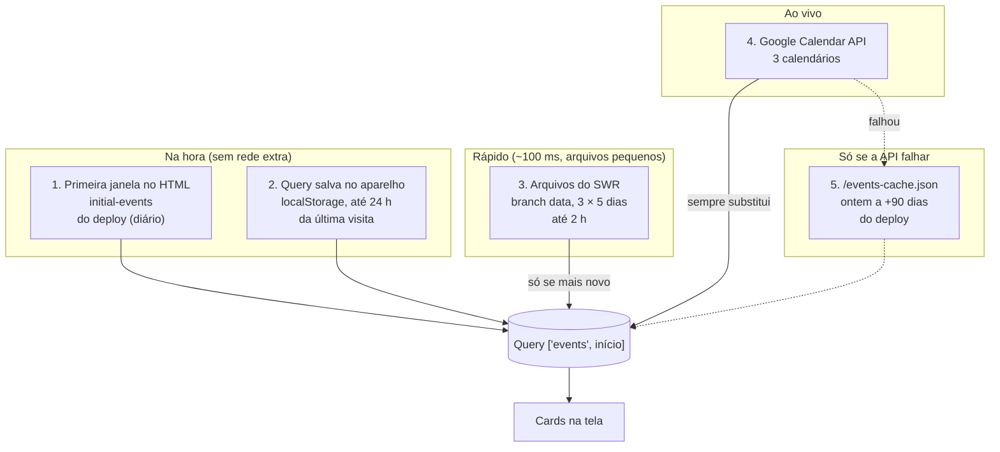
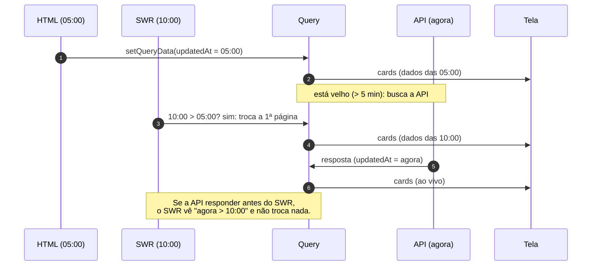
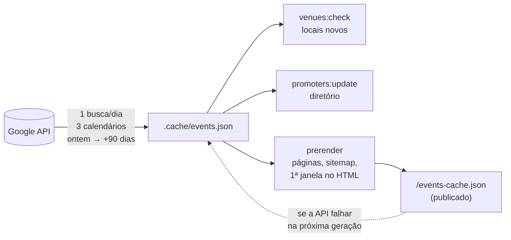
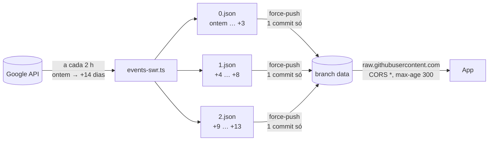

# 03. Cache e SWR

O objetivo: **a agenda aparece na hora**, sem esperar a Google Calendar API, e **fica correta** logo em seguida. Para
isso existem cinco camadas, da mais rápida (e mais velha) à mais nova.

## As camadas

| # | Camada | Frescor | Tamanho | Código |
|---|---|---|---|---|
| 1 | HTML do deploy | até ~24 h | ~86 KB no HTML (14 dias) | `scripts/prerender.ts`, `src/api/initialEvents.ts` |
| 2 | Aparelho (`localStorage`) | da última visita, até 24 h | o que a pessoa viu | `src/api/queryClient.ts` |
| 3 | SWR (branch `data`) | **até 2 h** | 3 arquivos: ~55, 24 e 14 KB (5–10 KB com gzip) | `scripts/events-swr.ts`, `src/api/swrEvents.ts` |
| 4 | Google Calendar API | ao vivo | 3 requisições por janela | `src/api/googleCalendar.ts` |
| 5 | Cache diário publicado | até ~24 h | ~570 KB (121 KB com gzip) | `scripts/lib/eventsCache.ts`, `src/api/eventsCache.ts` |

## A regra que junta tudo: "só entra o que for mais novo"

Toda camada grava na **mesma query** (`['events', início]`) com a data em que os dados foram gerados
(`updatedAt`). O TanStack Query considera velho o que passou do `staleTime` (5 min) e busca a API.

- O **SWR troca só a 1ª página** e mantém as outras já carregadas (ex.: quem rolou 4 semanas e voltou).
- Se a **API falhar**, fica o que estiver na query: HTML ou SWR. Na janela da API, os calendários que falharam entram
  pelo cache diário (camada 5).

## As otimizações de cada cache

### Cache diário (camada 5 e base dos scripts)

- **Uma busca, quatro usos.** Antes, venues, promoters e prerender chamavam a API cada um. Agora todos leem
  `.cache/events.json`, que é regenerado se tiver mais de 6 h.
- **De ontem a +90 dias.** Antes eram 30 dias para trás, que ninguém usava. Ontem fica porque até as 05:00 a agenda
  ainda mostra a noite anterior.
- **Só os campos usados** (`cacheItem`): sem `creator` e `organizer`, que trazem e-mails, já que o arquivo é público.
- **Tudo ou nada:** se um calendário falhar, o cache não é sobrescrito com um calendário a menos. Usa o publicado no
  site como base e, sem ele, o que estiver no disco.

### SWR (camada 3)

- **15 dias** = ontem e a 1ª janela da agenda (14 dias a partir de hoje). Cobre também a madrugada.
- **3 arquivos de 5 dias:** pequenos (5–10 KB com gzip cada), em paralelo. Um evento de vários dias entra em cada
  arquivo que toca, e o app tira os repetidos. Hoje o app busca os 3; o plano é desenhar o `0.json` antes (ver
  `SWR.md`).
- **Sem deploy:** o cron grava num branch órfão com um commit só, sobrescrito a cada vez, então o histórico não
  cresce. O site não é reconstruído.
- **Só usado se cobrir a janela inteira** (`swrWindow`): os arquivos precisam ser contíguos, da mesma geração e
  cobrir `[início, início + 14)`. Isso vale para "hoje" e "ontem". Outras datas vão direto para a API.
- **Memorizado por 5 min** no app (o loader roda a cada navegação até a agenda), além do cache HTTP de 5 min do
  `raw.githubusercontent.com`.
- **Preconnect** com `raw.githubusercontent.com` no `index.html`.

### Primeira janela no HTML (camada 1)

- O prerender embute no `index.html` os 14 primeiros dias, num `<script type="application/json">`. O `<` é
  escapado para não fechar a tag.
- Só vale se o primeiro dia embutido for o que o app pede (HTML de ontem, ou `?date=`, é ignorado) e se a query
  estiver vazia.
- Efeito medido: TBT de 320–380 ms para 70–180 ms (ver `LIGHTHOUSE.md`).

### Aparelho (camada 2)

- `PersistQueryClientProvider` com `localStorage`, `maxAge` de 24 h e `buster` (`events-v2-api`). Mudar o formato
  descarta o que estava salvo.
- Só as queries de `events` e `geocode` com sucesso.

## Linha do tempo de um dia

```mermaid
gantt
  title Atualizações (UTC)
  dateFormat HH:mm
  axisFormat %H:%M
  section Cache diário + deploy
  Update data e deploy  :05:00, 15m
  section SWR (a cada 2 h)
  SWR :00:17, 2m
  SWR :02:17, 2m
  SWR :04:17, 2m
  SWR :06:17, 2m
  SWR :08:17, 2m
  SWR :10:17, 2m
  SWR :12:17, 2m
  SWR :14:17, 2m
  SWR :16:17, 2m
  SWR :18:17, 2m
  SWR :20:17, 2m
  SWR :22:17, 2m
```

## O que cada visita vê primeiro

| Situação | Primeiro | Depois |
|---|---|---|
| 1ª visita, de dia | HTML do deploy | SWR (se mais novo) → API |
| Volta no mesmo dia | Aparelho | SWR (se mais novo que o salvo) → API |
| App instalado, HTML de dias atrás | Aparelho (se < 24 h) ou nada | SWR → API |
| `?date=` daqui a 3 semanas | (nada) | API |
| API bloqueada (cota, rede) | HTML / aparelho / SWR | Calendários que falharam vêm do cache diário |
| Offline | Aparelho (< 24 h) | Nada (sem rede) |
