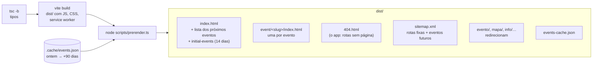
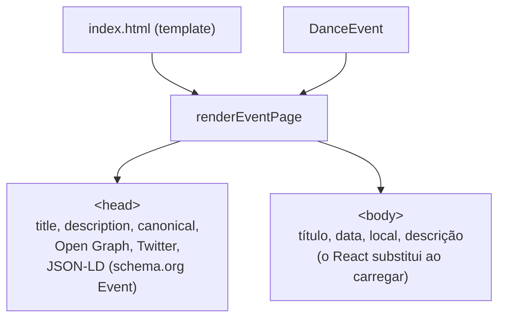
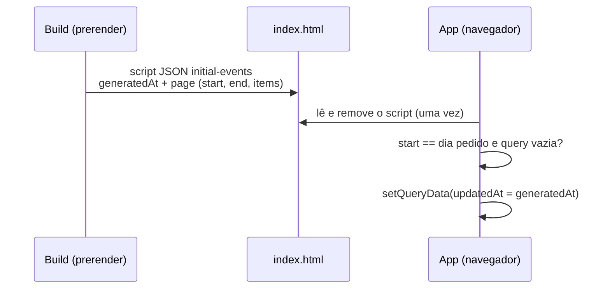

# 04. Build, SEO e páginas estáticas

O GitHub Pages só serve arquivos. Para buscadores e prévias de link (WhatsApp, Instagram) verem o conteúdo, o build
gera **páginas estáticas** depois do `vite build`: é o *prerender*.

## O build

- O prerender **usa o código do app no Node**: um servidor do Vite em modo `ssrLoadModule` (`scripts/lib/app.ts`). O
  HTML, o JSON-LD e o sitemap saem das mesmas funções do app (`src/seo/prerender.ts`).
- **Os eventos vêm do cache diário** (no deploy, gerado no passo anterior com a chave dos scripts). Com o mock, vêm do
  mock.

## Página de um evento

- **Quem lê:** buscadores e prévias de link leem o `<head>`. A pessoa vê o app, que substitui o conteúdo.
- **Quais eventos ganham página:** só os do período do cache, de ontem a +90 dias. O link de um evento mais antigo
  continua funcionando: o `404.html` abre o app, e o `eventsLoader` leva o feed ao dia do evento.
- **Links antigos** (`/evento/<slug>`): uma página que redireciona para `/event/<slug>/`.

## Sitemap

- Rotas fixas (`/`, `map/`, `community/`, `about/`) e **só os eventos futuros**.
- `lastmod` de cada evento = a última alteração no calendário (`updated` da API, no fuso de Lisboa). Sem ela, a data
  de hoje.

## Primeira janela no HTML

Os cards aparecem assim que o JavaScript carrega, sem esperar nenhuma rede. Ver [03](03-cache-and-swr.md).

## O que ainda limita o LCP

O React faz `createRoot().render()`: ele **descarta** o HTML gerado e redesenha. O caminho para o primeiro card já
estar pronto no HTML é renderizar o app no build e **hidratar** (`hydrateRoot`). Os detalhes estão no
`LIGHTHOUSE.md`, na seção "O que falta: LCP".
