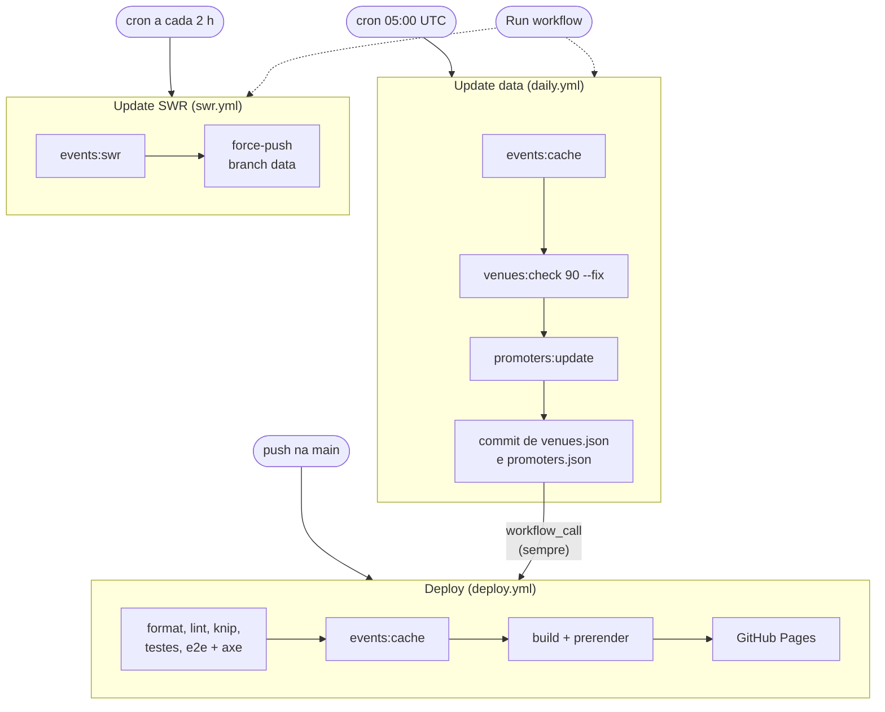
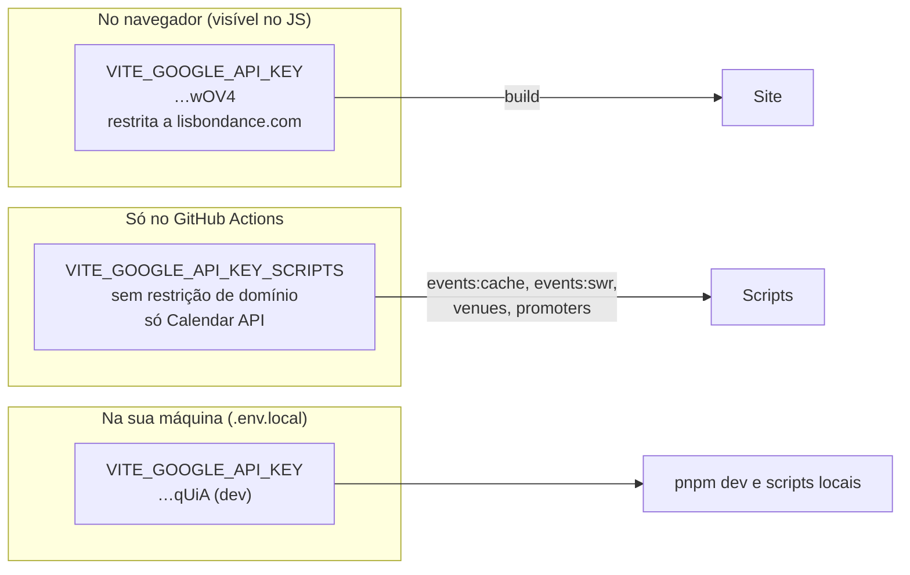
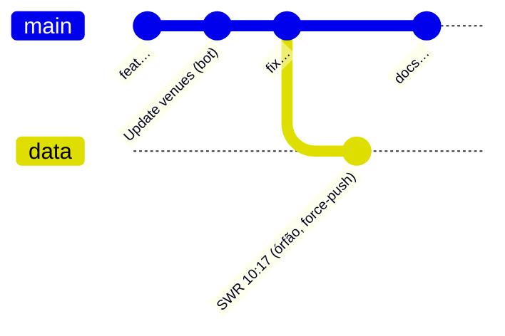

# 05. CI/CD e chaves

## Os três workflows

| Workflow | Quando | O que publica | Tempo |
|---|---|---|---|
| **Deploy** | push na `main`; chamado pelo Update data | O site (GitHub Pages) | ~5–10 min |
| **Update data** | 05:00 UTC, ou à mão | Commit de `venues.json`/`promoters.json`, depois o deploy | ~2 min + deploy |
| **Update SWR** | a cada 2 h (minuto 17), ou à mão | Branch `data` (`swr/0–2.json`) | ~1 min |

- **Deploy bloqueado por teste:** se qualquer verificação falhar, inclusive o e2e de acessibilidade, o site não muda.
  Foi o que aconteceu em 25/11, com um link de contraste baixo no tema escuro.
- **Push do bot:** um push feito com o `GITHUB_TOKEN` não dispara outro workflow. Por isso o Update data chama o
  deploy diretamente (`workflow_call`, `secrets: inherit`).

## As chaves do Google

- **Como os scripts escolhem a chave** (`scripts/lib/app.ts`): se `VITE_GOOGLE_API_KEY_SCRIPTS` existir, ela vira a
  `VITE_GOOGLE_API_KEY` que o código do app lê. Senão, usa a do site. O log mostra qual foi usada (`venues: chave da
  API dos scripts`).
- **Referer:** os scripts mandam `Referer: https://lisbondance.com/` nas chamadas à API. Por isso funcionam até com a
  chave restrita ao domínio. A chave dos scripts existe para não depender disso e para permitir restringir mais a do
  site.
- **Todos os passos do Update data recebem as duas chaves.** Venues e promoters carregam o código do app, que exige
  uma chave com dados reais mesmo lendo só o cache.
- **O build do site recebe só a chave do site.** A dos scripts nunca entra no JavaScript publicado: o código do
  site não a lê, só os scripts Node.

## Secrets e variables (Settings → Secrets and variables → Actions)

| Nome | Tipo | Usado em |
|---|---|---|
| `VITE_GOOGLE_API_KEY` | Secret | Build do site; fallback dos scripts |
| `VITE_GOOGLE_API_KEY_SCRIPTS` | Secret | events:cache, events:swr, venues, promoters |
| `VITE_USE_MOCK` | Variable | `false` = API real no deploy |
| `VITE_GOATCOUNTER_CODE` | Variable | Analytics (`cid360`) |

## Branches

- **`main`:** o código. Todo push dispara o deploy.
- **`data`:** órfão, sem histórico em comum com a `main`. Tem um commit só, substituído a cada 2 h. Nunca é mesclado.
