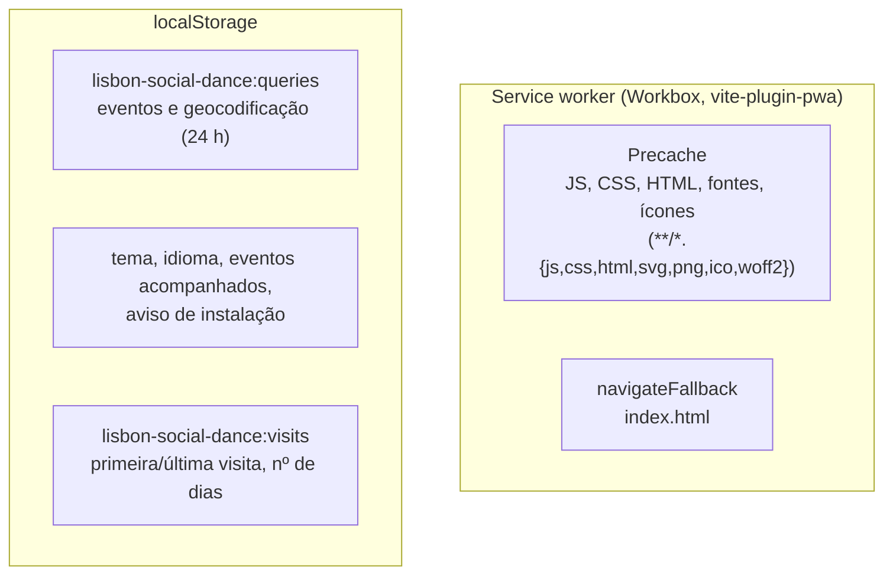
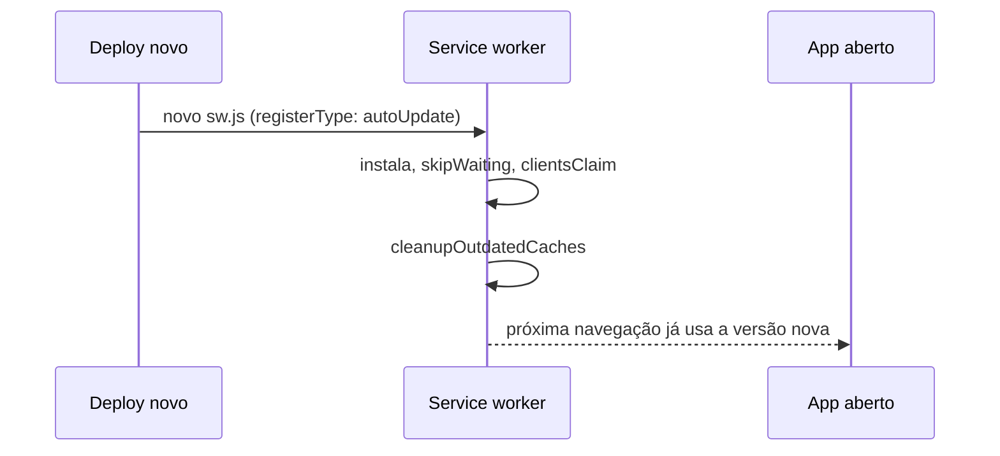

# 06. PWA e offline

O app é instalável (Android, iPhone, desktop) e abre sem internet com os últimos eventos vistos.

## O que fica no aparelho

- **O que não entra no precache:**
  - `/events-cache.json` (570 KB), que só é usado quando a API falha;
  - os arquivos do SWR, que estão em outro domínio.
- **Offline:** o app abre pelo service worker, e os eventos saem do `localStorage` (até 24 h).

## Atualização

- Sem botão de "atualizar": a versão nova assume sozinha.
- Quem instalou o app vê o nome e o ícone novos do manifest só depois que o sistema atualiza. No iOS, é preciso
  reinstalar.

## Relação com os caches de dados

O service worker cuida do **app** (código e telas). Os **eventos** ficam com o TanStack Query (aparelho) e com as
camadas de [03. Cache e SWR](03-cache-e-swr.md). O próximo passo previsto no `SWR.md` é um `StaleWhileRevalidate` no
Workbox para os arquivos do SWR, para abrir offline com dados de até 2 h.
