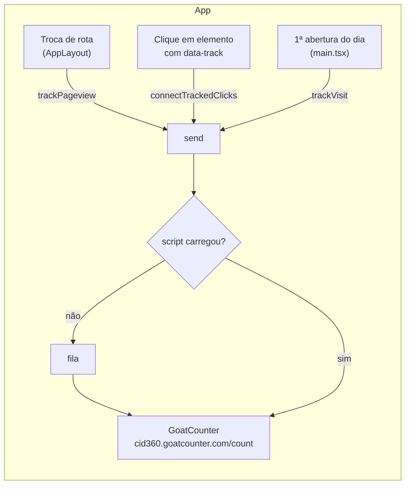
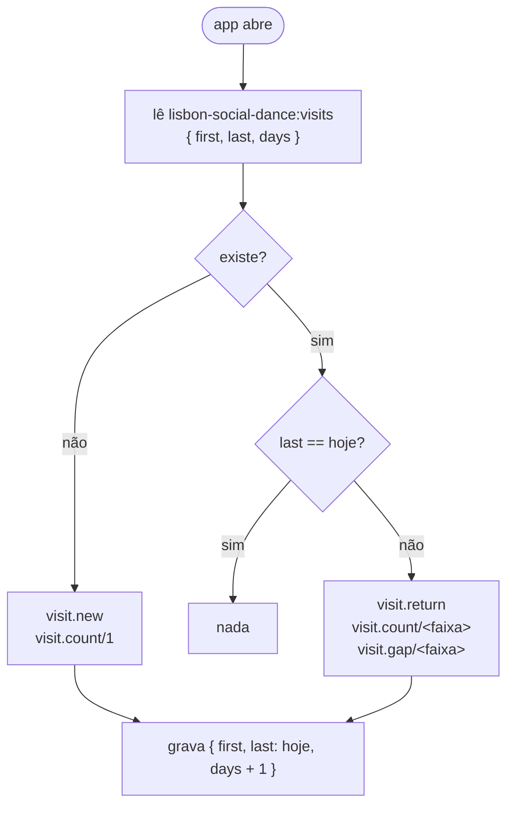

# 07. Analytics e privacidade

[GoatCounter](https://www.goatcounter.com), código `cid360`. Não usa cookies, não guarda IP e não identifica ninguém.
Fica ligado só com `VITE_GOATCOUNTER_CODE` e fora do `pnpm dev`.

## O que é enviado

| Tipo | Exemplo | Quando |
|---|---|---|
| Página vista | `/`, `/event/<slug>/`, `/about` | A cada troca de rota (SPA: `no_onload`) |
| Clique | `filters.genre/Salsa`, `dates.strip-day/2026-11-26` | Elementos com `data-track` (`src/analytics/track.ts`) |
| Evento aberto | `event.open` (total) e `event.open/<slug>` (qual) | Os dois: quantos e quais |
| Visita | `visit.new`, `visit.return`, `visit.count/3-5`, `visit.gap/2-7d` | Uma vez por dia por aparelho |

## Recorrência sem identificador

- **Faixas:**
  - total de dias: `1`, `2`, `3-5`, `6-10`, `11+`;
  - intervalo desde a última visita: `1d`, `2-7d`, `8-30d`, `30d+`.
- **Nada sai do aparelho além da faixa:** sem UUID e sem data exata. O GoatCounter recebe contagens agregadas
  ("quantos voltaram depois de 2–7 dias"), não pessoas.

## Privacidade

- A página **Sobre** tem uma seção "Privacidade" (fim da página) explicando, sem citar a ferramenta:
  - sem cookies e sem identificação;
  - contagem anônima e agregada de páginas, cliques e retornos;
  - o resto fica só no aparelho.
- **Terceiros que recebem o IP de quem usa o site:**
  - o GoatCounter, que não o guarda;
  - o Google, pela Calendar API chamada do navegador.
- **Bloqueadores** (ex.: Brave Shields) barram o GoatCounter. O app não quebra: as contagens ficam na fila e são
  descartadas.
