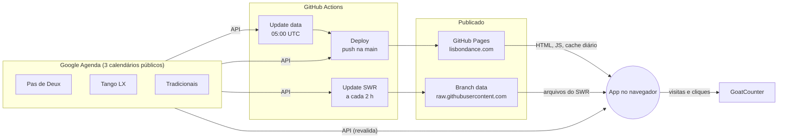

# Documentação técnica

Como o Lisbon Dance with Pas de Deux funciona por dentro. Os diagramas estão em [Mermaid](https://mermaid.js.org/): o GitHub e o
VS Code (com a extensão *Markdown Preview Mermaid Support*) os desenham.

| Documento | O quê |
|---|---|
| [01. Arquitetura](01-architecture.md) | Visão geral: app, rotas, dados, estado, PWA, scripts e hospedagem |
| [02. Dados dos eventos](02-event-data.md) | Os 3 calendários, a Google Calendar API, a normalização e o que acontece quando um falha |
| [03. Cache e SWR](03-cache-and-swr.md) | As camadas de cache, a otimização de cada uma e o SWR (stale-while-revalidate) |
| [04. Build, SEO e páginas estáticas](04-build-seo-prerender.md) | `vite build` + prerender: páginas dos eventos, sitemap, primeira janela no HTML |
| [05. CI/CD e chaves](05-ci-cd-and-keys.md) | Os 3 workflows (deploy, Update data, Update SWR), os secrets e as chaves do Google |
| [06. PWA e offline](06-pwa-and-offline.md) | Service worker, o que fica no aparelho e como o app se atualiza |
| [07. Analytics e privacidade](07-analytics-and-privacy.md) | GoatCounter, cliques marcados, recorrência de visitas e o que não é coletado |

Relacionados, na raiz do repositório:

- [`SWR.md`](../../SWR.md): o plano do SWR e os próximos passos;
- [`LIGHTHOUSE.md`](../../LIGHTHOUSE.md): as medições de desempenho;
- [`README.md`](../../README.md): como rodar e as variáveis de ambiente;
- [`TODO.md`](../../TODO.md): o que falta.

## Mapa geral

